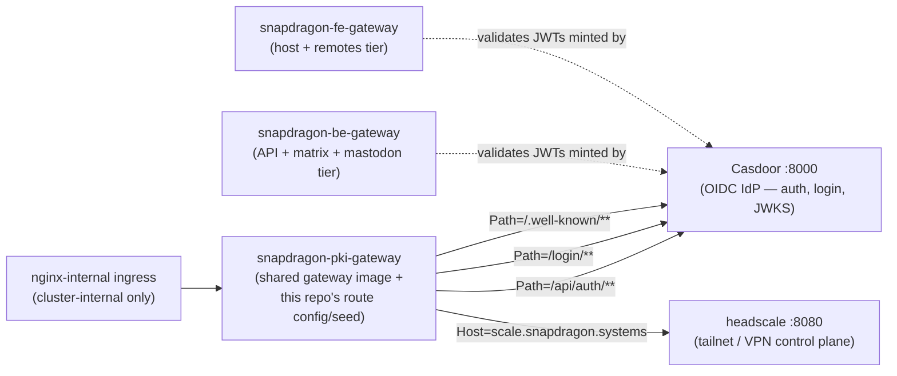

# snapdragon-pki-gateway

Per-node-type instance of the Snapdragon Spring Cloud Gateway — the **identity
tier** front door. It fronts Casdoor (auth / login / OIDC) and headscale (the
VPN/tailnet control plane). Internal-only (ingress class `nginx-internal`),
never internet-facing, and it validates the internal Casdoor JWT — no external
login is exposed.

It is **the same image and code as
[snapdragon-gateway](https://github.com/Snapdragon-Systems/snapdragon-gateway)**.
Like its [be-](https://github.com/Snapdragon-Systems/snapdragon-be-gateway) and
[fe-gateway](https://github.com/Snapdragon-Systems/snapdragon-fe-gateway)
siblings this repo is a **thin overlay**: only the `SPRING_APPLICATION_NAME`, the
Postgres-backed route set (Liquibase), and the downstream URIs differ. The image
builds `FROM` the shared gateway image so every device runs identical, audited
gateway code — the same security filter chain, RBAC, domain-scoping converter,
and Cassandra-cached revocation / route-access / URL registry.

```bash
# bases off the sibling snapdragon-gateway image (GATEWAY_IMAGE build-arg)
docker build -t snapdragon-systems/pki-gateway:dev .
```

## Tier & namespace

| | |
|---|---|
| **Tier** | identity / PKI |
| **Namespace** | `snapdragon-pki` (downstreams resolve at `*.snapdragon-pki.svc.cluster.local`) |
| **`SPRING_APPLICATION_NAME`** | `snapdragon-pki-gateway` (set in the `Dockerfile`; selects this instance's route-access rows) |
| **Listen port** | `8080` (the gateway itself, `EXPOSE`d in the `Dockerfile`); downstreams are Casdoor `:8000` and headscale `:8080` |
| **Ingress** | `nginx-internal` — cluster-internal only, never internet-facing |
| **Sibling gateways** | `snapdragon-be-gateway` (API + matrix + mastodon), `snapdragon-fe-gateway` (host + remotes) |

## What it routes

The route table is config-driven (`application-pki.yml`, mirrored into the
`gateway_routes` Liquibase seed). All four routes are identity-tier
downstreams in the `snapdragon-pki` namespace:



*Solid arrows are this gateway's own proxied routes; dashed arrows show why
the sibling gateways depend on the Casdoor this gateway fronts (they validate
JWTs it mints, per [How it relates](#how-it-relates-to-the-gateways--casdoor--federation--multi-tenancy)
below) — they do not send traffic through this gateway itself.*

| Route id | Predicate | Downstream | Purpose |
|----------|-----------|------------|---------|
| `casdoor-auth` | `Path=/api/auth/**` | Casdoor `:8000` | OAuth2 / token endpoints |
| `casdoor-login` | `Path=/login/**` | Casdoor `:8000` | hosted login UI |
| `casdoor-oidc` | `Path=/.well-known/**` | Casdoor `:8000` | OIDC discovery / JWKS |
| `headscale` | `Host=scale.snapdragon.systems` | headscale `:8080` | tailnet / VPN control plane |

`CASDOOR_URI`, `CASDOOR_ISSUER_URI`, and `HEADSCALE_URI` are env-overridable
(defaults point at the in-namespace services). `CASDOOR_ISSUER_URI` is the
issuer the OAuth2 resource server validates JWTs against.

> **SCG-5 route-prefix note (DONE).** Spring Cloud Gateway 5.0 (the
> Spring Boot 4 baseline this fleet now runs) moved static route config from
> `spring.cloud.gateway.routes` to `spring.cloud.gateway.server.webflux.routes`;
> the legacy prefix is **silently ignored and binds zero routes**.
> `application-pki.yml` has been **migrated** to
> `spring.cloud.gateway.server.webflux.routes` (matching the sibling
> be-/fe-/snapdragon-gateway configs), so the standalone/local-dev mirror binds
> its casdoor + headscale routes under SCG-5. The deployed source of truth is the
> Postgres-backed `gateway_routes` rows (seeded by
> [`liquibase/changelog/001-gateway-routes.xml`](liquibase/changelog/001-gateway-routes.xml)
> and rendered by the generator Application), which is loaded by the shared
> image's route loader and is **not** affected by the YAML-prefix move.

## Role gates (inherited from the shared image)

Authorization is enforced by the shared gateway code, not re-implemented here.
After Spring Security authenticates the Casdoor JWT, the per-gateway
external-access gate consults the admin-managed `gateway_route_access` rows for
`snapdragon-pki-gateway` (the `gateway_route_access` table is the source of
truth, applied by the shared `GatewayRouteAccessFilter`). When neither Postgres
nor Cassandra is reachable the gate falls back to the **baked-in canonical
seed** for this tier (so it is never silently fail-open):

| URL pattern | Role |
|-------------|------|
| `/api/auth/**` | `ROLE_USER` |
| `/login/**` | `PUBLIC` (anonymous-allowed) |
| `/.well-known/**` | `PUBLIC` (anonymous-allowed) |

Login and OIDC discovery are deliberately `PUBLIC` so an unauthenticated visitor
can reach the login page and a client can fetch JWKS; the token surface floors
to `ROLE_USER`. Infra/observability paths (`/actuator/**`, …) stay gated to
`GAME-MASTER` / `ADMIN` / `SUPERADMIN` by the shared `SecurityConfig`.

> **`GAME-MASTER` is the games-tier name of the platform `MOD` authority** in
> the canonical `superadmin → admin → mod → user` cascade. The shared image's
> `Roles.isGameMaster()` matches the literal Casdoor role name `GAME-MASTER` /
> `GAME_MASTER` (both spellings), and `SecurityConfig` / the route-access and
> resource-access filters gate and own-domain-bypass on exactly that name — so
> this doc uses `GAME-MASTER` where it is naming what the inherited code emits,
> not a typo for `MOD`.

> **What is provided here vs by the shared image.** The route-access rows and
> the baked-in canonical seed/fallback above are **provided and enforced by the
> shared `snapdragon-gateway` base image** (and CRUD'd at runtime by admin-bff —
> see [Source of truth](#source-of-truth)). THIS repo only seeds the
> `gateway_routes` *route-definition* table
> ([`liquibase/changelog/001-gateway-routes.xml`](liquibase/changelog/001-gateway-routes.xml));
> it does **not** ship any `gateway_route_access` seed of its own.

## How it relates to the gateways / Casdoor / federation / multi-tenancy

- **Casdoor (auth) lives behind this gateway.** This is the door every other
  tier's tokens come from: the be/fe gateways and BFFs validate JWTs *minted*
  by the Casdoor this gateway fronts. The platform runs **one Casdoor per
  brand**, so the cryptographically-validated `iss` claim is the trustworthy
  tenant discriminator.
- **Opaque-session bridge (inherited from the shared image).** The browser
  never holds a Casdoor JWT. login-ui drives a Casdoor OIDC authorization-code
  (PKCE) redirect and user-bff performs the server-side code→token exchange,
  holding per-session JWT custody/refresh; the browser only ever carries an
  **opaque `bff_`-prefixed session**. A pre-security exchange filter in the
  shared gateway code swaps `bff_` → the internal custody JWT before Spring
  Security runs, so this gateway stays a **pure Casdoor-JWT OAuth2 resource
  server** and its JWT validation + role gate run unchanged. This overlay
  inherits that behavior from the base image; nothing about it is configured
  here beyond `CASDOOR_ISSUER_URI`.
- **Issuer-keyed domain scoping (foundation on the shared image).** The shared
  `CasdoorAuthorities` converter stamps every authenticated principal with
  exactly one issuer-derived `DOMAIN_<x>` authority (a non-role authority,
  `DOMAIN_default` on single-issuer clusters), resolved through the
  `DomainRegistry` from the validated issuer — never a user-settable claim. A
  reserved-prefix guard drops any `permissions` entry beginning `ROLE_` /
  `DOMAIN_`, closing the authority-injection / cross-domain-escalation hole.
- **Least-privilege cascade.** `SUPERADMIN > ADMIN > MOD > USER` (the
  games-tier name for `MOD` is `GAME-MASTER` — see the note under
  [Role gates](#role-gates-inherited-from-the-shared-image)). `SUPERADMIN`
  is the only cross-domain bypass (the infra control plane); `ADMIN` /
  `GAME-MASTER` bypass only within their own domain; and any non-superadmin
  whose `DOMAIN_<x>` does not match the request's target brand is hard-denied
  before the grant layer is even consulted. `ROLE_IMAGE_BUILDER` is a separate
  per-domain capability.
- **Multi-brand.** A per-brand instance is named `${BRAND}-pki-gateway`; the
  shared image derives its tier (and the right seed) by the `-pki-gateway`
  suffix, so a runtime-added brand gateway is closed-by-default until its
  Postgres rows load. headscale gives the platform its Tailscale-only federated
  reach for remote modules and the superadmin tailnet console.

## Source of truth

The route table and per-instance config that actually run in the cluster come
from the generator's ArgoCD Application
[`specs/cluster/apps/20-gateway-pki.yaml`](https://github.com/Snapdragon-Systems/snapdragon-generator/blob/main/specs/cluster/apps/20-gateway-pki.yaml),
which renders the shared `snapdragon-gateway` Helm chart with `instance.name:
snapdragon-pki-gateway` and the pki `routes`. The admin-bff
(`snapdragon-admin-bff-api`) CRUDs the `gateway_route_access` rows. This repo's
`application-pki.yml` and `liquibase/changelog` are the standalone/local-dev
mirror of that same identity; keep them in sync with the generator Application,
which stays the deployed source of truth.

## Known Gaps / TODO

- **Liquibase seed rows can silently drift from `application-pki.yml`.** The
  `gateway_routes` insert statements in
  [`liquibase/changelog/001-gateway-routes.xml`](liquibase/changelog/001-gateway-routes.xml)
  hardcode the Casdoor/headscale URIs as plain literals — Liquibase XML does
  not support Spring's `${VAR:default}` relaxed-binding syntax used in
  `application-pki.yml` — so a `CASDOOR_URI` or `HEADSCALE_URI` env override
  applied at deploy time will **not** propagate to these seeded fallback rows.
  If the defaults in either file are ever changed, the other must be updated
  by hand (see the changeSet comment in that file and the "Source of truth"
  section above).

## CI

The only pipeline is [`.gitlab-ci.yml`](.gitlab-ci.yml): a single `build` stage
that bases off the sibling `snapdragon-gateway` image (`GATEWAY_IMAGE`
build-arg) and pushes this overlay to the in-cluster GitLab registry on the
privileged `snapdragon-x86` runner, only on the default branch or a tag. No keys
are baked in. **CI is GitLab-only** — there are intentionally no GitHub Actions
(`.github/workflows/`) in this repo, in line with the platform's CI = GitLab
ONLY standard.

## Testing

This is a **config-only overlay with no source or tests of its own**. All
gateway behavior — the security filter chain, RBAC, the issuer-keyed
domain-scoping converter, the `bff_`→JWT exchange filter, and the route-access /
resource-access filters (including the `GAME-MASTER`/`ADMIN` own-domain bypass
and the reserved-prefix guard) — is unit- and e2e-tested in
[snapdragon-gateway](https://github.com/Snapdragon-Systems/snapdragon-gateway).
What this repo contributes is the route config (`application-pki.yml`) and the
`gateway_routes` seed; the meaningful check here is that they stay in sync with
the deployed generator Application (see [Source of truth](#source-of-truth)). An
earlier branch carried Java source and a Playwright/Gherkin e2e suite; those
were removed when the repo was refactored into a pure thin overlay and now live
in the shared gateway repo.

## Current State

- **Ecosystem baseline.** The fleet now runs **Spring Boot 4.0.7 / Spring Cloud
  2025.1.2** on **Java 25 LTS** (`eclipse-temurin:25`), with shared Maven
  artifacts `snapdragon-parent` (metapom
  2.7.0), `snapdragon-commons` (shared security/tenancy, `systems.snapdragon.commons.*`,
  2.7.0) and the new `snapdragon-auth-core` (2.3.0, shared
  account/session/MFA/Casdoor-admin infra; consumed by user-bff and admin-bff
  only — **not** by this gateway). This overlay carries no Java of its own, so
  it inherits the baseline entirely through the shared `snapdragon-gateway`
  base image; there is no Boot-version pin in this repo.
- **Auth model (live this cycle).** Casdoor is the SSO IdP. login-ui runs the
  OIDC authorization-code (PKCE) redirect; **user-bff** performs the
  server-side code→token exchange and holds per-session JWT custody/refresh; the
  browser only ever holds an opaque `bff_` session. The gateway remains a pure
  Casdoor-JWT resource server, with the shared image's pre-security exchange
  filter swapping `bff_` → the internal custody JWT. Login/session/account
  *logic* is being relocated from admin-bff to user-bff (shared core extracted
  to `snapdragon-auth-core`); the account/session **data** stays in
  admin-bff-db, reached by user-bff over mTLS + `X-Internal-Token`. None of this
  is configured in this repo — it is named here only so the docs match the
  current platform reality and do **not** imply login lives in admin-bff.
- **Authorization data path.** `gateway_route_access` (Postgres) is the source
  of truth, applied by the shared `GatewayRouteAccessFilter`; ADMIN /
  GAME-MASTER bypass within their own domain, SUPERADMIN cross-domain.
- **SCG-5 route namespace.** SCG 5.0 moved static route config to
  `spring.cloud.gateway.server.webflux.routes`; `application-pki.yml` has been
  migrated off the legacy `spring.cloud.gateway.routes` prefix (see the note
  under [What it routes](#what-it-routes)). The deployed Postgres-backed
  `gateway_routes` path is unaffected.
- **Cloudflare** fronts prod (this gateway stays internal-only behind it).
- Everything in the sections above is shipped on `main`.

## Roadmap

State legend: ✅ shipped (on `main`) · 🚧 in-flight (open branch/PR, not merged) ·
🔭 planned (design only). Everything documented above is ✅ shipped. The remaining
items below are **not** yet enforced by this overlay — they land via the shared
`snapdragon-gateway` image and admin-bff changelogs, and this repo inherits them
when those ship.

- ✅ **SCG-5 static-route prefix rename.** `application-pki.yml` migrated from
  `spring.cloud.gateway.routes` to `spring.cloud.gateway.server.webflux.routes`
  so the static config binds routes under Boot 4 / SCG 5 (matches the sibling
  be-/fe-/snapdragon-gateway configs). The deployed Postgres `gateway_routes`
  path already worked; this fixes the image's baked static config too.
- 🚧 **SSO end-to-end + e2e.** The Casdoor OIDC → user-bff custody-JWT →
  opaque `bff_` session flow (with the gateway's `bff_`→JWT exchange filter) is
  being brought up live end-to-end and covered by e2e. The gateway behavior is
  in the shared image; this overlay inherits it.
- 🔭 **MFA / step-up on identity-tier routes.** Casdoor MFA is design-complete
  (WebAuthn + TOTP + recovery; per-role defaults; admin-bff Liquibase 150-band).
  Enforcement is via a planned, fail-closed `gateway_route_access.mfa_required`
  column plus an `amr`/`acr` → `MFA_SATISFIED` authority. Because this gateway
  consumes `gateway_route_access` rows from the shared image, identity-tier
  routes will gain MFA / step-up enforcement once the 150-band changelog and
  shared-image support land. MFA is **not** enforced today.
- ✅ **Continuous-OWASP security CI stage — DECIDED: this overlay is EXEMPT.**
  The platform pen-test standard adds a shared `.gitlab-ci.yml` `include`
  (ZAP DAST + Dependency-Check SCA + nuclei + k6) to app/service repos.
  Decision (2026-07 hygiene pass): gateway-config overlays like this repo are
  **exempted**, for two verifiable reasons. (1) This repo contains no
  dependency manifest and no application code — only a `Dockerfile`,
  `application-pki.yml`, and Liquibase changelogs — so a Dependency-Check SCA
  job here would scan nothing and report a vacuous green. (2) Every byte of
  runtime behavior comes from the shared `snapdragon-gateway` image, whose own
  repo carries the full pen-test stage jobs (`pentest:sca` + `pentest:dast`
  extending the centralized generator template — see that repo for the current
  execution status of its DAST leg); a DAST run from this repo would re-scan
  that sibling artifact, double-counting coverage without testing anything this
  overlay adds. **Revisit trigger:** if this overlay ever gains its own
  dependency manifest or app surface (anything beyond config/changelogs), it
  MUST adopt the shared `include` like the app/service repos.
